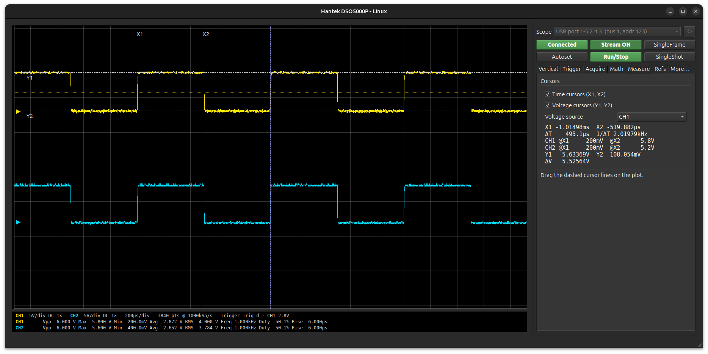
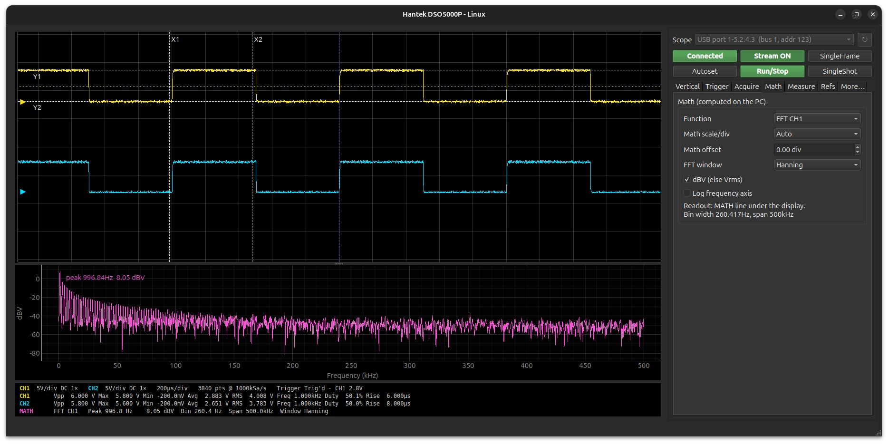
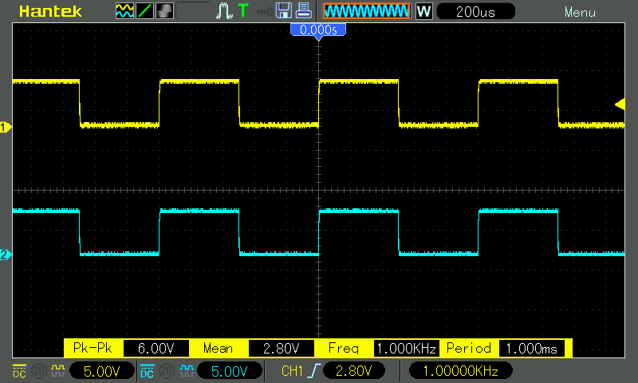

# hantek-dso

**An open-source Linux client for Hantek DSO5000P series oscilloscopes**
(DSO5102P, DSO5202P, and DSO5000P-firmware variants), replacing the Windows-only
"Scope" software that ships with the instrument.



It talks to the scope over its rear USB *device* port, using a protocol
reverse-engineered from the scope firmware and the original Windows
application. It needs no Windows driver and no Wine; it runs as a Python
program on top of libusb.

## Features

- **Live waveforms** for CH1 and CH2, streamed over USB. Both channels come from
  the same acquisition, drawn on a scope-style grid that matches the scope's own
  screen (16 divisions, or 19.2 when its side menu is hidden), with ground
  markers and a draggable trigger-level line
- **Scope-style controls**: Run/Stop lights green while the scope captures
  continuously and red when stopped; SingleShot glows orange while waiting for
  its trigger, then shows the captured waveform. Stream ON/OFF pauses the
  display without touching the scope; SingleFrame reads one frame
- **Stopped scope**: the scope won't send waveform data while stopped, so the
  app then extracts the traces from the scope's screen (accurate to ≈ 0.03 div)
  and marks the plot *[Data Transfer Loss - Scope Screen Scraped]*
- **Vertical controls**: channel on/off, V/div, coupling, probe ×1…×1000,
  20 MHz bandwidth limit, and a position slider per channel that previews on the
  plot while dragging and sends one update on release, with a Zero button
- **Horizontal & acquisition**: 2 ns/div … 40 s/div, Normal / Peak detect /
  Average (4…256), memory depth 4K / 20K / 40K
- **Trigger**: Edge, Video (polarity, NTSC/PAL, sync, line), Pulse (polarity,
  =/≠/>/<, width), Slope (direction, condition, V1/V2 thresholds, time),
  Overtime and Alternate. Also source, Auto/Normal mode, coupling, a level
  slider (previewed on the plot, Center button), 50 %, level → 0 V, force trigger,
  holdoff, horizontal trigger position, plus live trigger status and the scope's
  hardware frequency counter
- **Math & FFT** (computed on the PC): CH1±CH2, CH2−CH1, CH1×CH2, and an FFT of
  either channel with five window functions, dBV or Vrms, linear or log
  frequency axis, and an interpolated peak readout
- **Measure tab**: draggable time (X1/X2) and voltage (Y1/Y2) cursors with ΔT,
  1/ΔT, ΔV and the value of each trace at each cursor
- **Reference waveforms**: two slots (REF A/B). Store them from CH1, CH2 or Math,
  overlay them on live data, and save or load them as CSV
- **Live readout** under the display: a settings line plus one line per channel
  (in channel colours) with Vpp, max, min, average, RMS, frequency, duty cycle
  and rise time in fixed columns, and a clipping warning. A third MATH line
  appears while a math function is on (the FFT version shows peak, bin width
  and span)
- **Front-panel keys** pressed remotely: Autoset, Run/Stop, SingleShot, force
  trigger, scope menu on/off, reset to defaults (with confirmation) and others
- **Several scopes**: pick which one by USB port (remembered between runs)
- **Export**: waveforms (and math) to CSV in volts, and 800 × 480 PNG screenshots of
  the scope's own display
- **Full-record capture**: the whole acquisition record (up to 40 000 points
  instead of the 3200 on screen) through the scope's CSV export to a USB stick
  in its front port; from the GUI (Acquire tab), the CLI or the API
- **Command-line tool and Python API** for scripting and automated measurements



The scope's display, captured over USB with `hantek-dso screenshot`:



## Requirements

- Linux with libusb 1.0 (installed on most desktops)
- Python ≥ 3.10
- A Hantek DSO5000P-series scope connected via its rear **USB device** port
  (the scope enumerates as `049f:505a`)

Tested with a DSO5102P (modified to 200 MHz) running firmware 3.40.0 (210225).

## Installation

```bash
git clone https://github.com/kooscode/hantek-dso5000p-linux.git && cd hantek-dso5000p-linux
./run.sh          # first run creates .venv, installs everything, then starts the GUI
```

Or manually:

```bash
python3 -m venv .venv
.venv/bin/pip install -e '.[gui]'        # omit [gui] for CLI/API only
```

### USB permissions (one-time)

Normal users can't open the scope's USB device until you add the bundled udev rule.
The rule also stops NetworkManager from treating the scope as a network adapter: Linux
otherwise binds it to the `cdc_subset` USB-network driver.

```bash
sudo cp udev/99-hantek-dso5000p.rules /etc/udev/rules.d/
sudo udevadm control --reload
sudo udevadm trigger --action=add --subsystem-match=usb --attr-match=idVendor=049f
```

Replugging the USB cable also applies the rule.

## Usage

### GUI

```bash
.venv/bin/hantek-dso-gui
```

or simply `./run.sh`. The GUI connects automatically and starts streaming. Every
control reads its state back from the scope, so the window follows changes you
make on the scope's front panel.

| Area | Contents |
|---|---|
| Top row | Scope selector · **Connected/Disconnected** · **Stream ON/OFF** · **SingleFrame** |
| Second row | **Autoset** · **Run/Stop** (green running / red stopped) · **SingleShot** (orange while armed) |
| Vertical | per channel: on/off, V/div, coupling, probe, bandwidth limit, position slider + Zero |
| Trigger | type, source, mode, coupling, level slider + Center, 50 %, level → 0 V, force, holdoff, horizontal trigger position, per-type parameters |
| Acquire | time/div, acquisition mode, averages, memory depth, full-record capture |
| Math | CH1±CH2, CH2−CH1, CH1×CH2, FFT |
| Measure | time and voltage cursors |
| Refs | two reference waveforms |
| More… | Reset Defaults, Scope Menu on/off, Scope Screenshot, Save CSV |

### Command line

```bash
hantek-dso devices                       # list connected scopes (USB port paths)
hantek-dso -d 1-5.2.4.3 info             # use a specific scope (default: first found)
hantek-dso info                          # ping the scope and print a summary
hantek-dso settings                      # dump all 208-byte settings fields
hantek-dso wave all --csv capture.csv    # waveforms of all channels, in volts
hantek-dso screenshot screen.png         # the scope's display as PNG
hantek-dso key list                      # list front-panel key names
hantek-dso key CT-AUTOSET-KEY            # press Autoset
hantek-dso set VERT-CH1-VB=10 TRIG-SRC=1 # change settings fields
hantek-dso full ch1 -o full.csv         # whole record (needs a USB stick in the scope)
hantek-dso file /protocol.inf -o p.inf   # download a file from the scope
hantek-dso --debug info                  # hex-dump all USB traffic
```

### Python API

```python
from hantek_dso import DSO5000P
from hantek_dso.analysis import measure

with DSO5000P() as scope:
    st = scope.read_settings()
    ch1, ch2 = scope.read_waveform(4)          # both channels, same acquisition
    t, v1 = st.time_axis(len(ch1.samples)), st.to_volts(1, ch1.as_int8())
    print(measure(t, v1)["Freq"])              # '1.0004kHz'

    scope.set_timebase(15)                     # 200 µs/div
    scope.set(**{"TRIG-EDGE-SLOPE": 1})        # falling edge
    scope.press_key("CT-RS-KEY")               # Run/Stop
```

**[api/API.md](api/API.md)** documents the full API, with recipes for
logging, single-shot capture and trigger setup. **[api/scope_logger.py](api/scope_logger.py)**
is a small example app: a measurement logger with live table and CSV output.

## How it works

The scope runs embedded Linux. Its USB device port is a `g_serial` gadget in
vendor mode (bulk endpoints `0x02`/`0x81`), which the scope application reads as
`/dev/ttyGS0`. Requests and replies are framed as:

```
'S'  len_lo  len_hi  cmd  payload…  checksum(sum of preceding bytes)
```

The protocol covers settings read/write, waveform streaming, screenshots,
key presses, file transfer and more. The settings block is table-driven; its
layout comes from `/protocol.inf` on the scope.
**[protocol/PROTOCOL.md](protocol/PROTOCOL.md)** has the full reference. It marks which
details were verified on hardware and which were only read from the firmware.

## Safety notes

- Not every settings field can be written safely. The scope applies vertical
  and trigger fields immediately. It ignores timebase and trigger-mode writes,
  so the client changes those via front-panel key presses. Writing the
  memory-depth field **crashed and rebooted** the test scope. `set()` therefore
  accepts only fields that have been tested, unless you pass `force=True`.
- The firmware also has a factory/debug protocol that can run shell commands and
  write flash. The client uses it only to list and delete its own CSV file on
  the USB stick during full-record capture.
- Writing settings while a scope menu is open and a USB stick is mounted once
  froze the scope application (power cycle needed). The client therefore drives
  menus with key presses and closes them again.

## Known limitations

- **Record length:** the USB waveform command returns only the record shown on
  screen (up to 200 / 400 / 800 points per division at 4K / 20K / 40K). The
  original Windows software uses the same command. Full records of up to 40 000
  points can be fetched through the scope's CSV export to a USB stick (see
  [protocol/PROTOCOL.md §3.3](protocol/PROTOCOL.md#33-full-records-via-the-scopes-csv-export-hw)).
- **Stopped scope:** traces are taken from the scope's screen, so they have
  about 40 points per division instead of the full USB density.
- **SingleSeq pressed on the scope itself** can't be detected until it triggers
  (the scope reports the same state as "running, waiting"); SingleShot pressed
  in the app is shown correctly.
- **512K / 1M / 2M depths:** firmware 3.40 disables them, and the protocol can't
  select them. A firmware patch made them selectable, but the scope's
  acquisition code doesn't implement them (noise), so they aren't available.
- **Alternate trigger:** each channel's own trigger setup is configured on the
  scope itself.
- **Math and FFT run on the PC:** the scope's built-in math channel isn't mirrored.
- **One connection at a time:** only one program can hold the USB connection.

## Troubleshooting

| Symptom | Fix |
|---|---|
| `Access denied (insufficient permissions)` | Install the udev rule (above) and replug the scope |
| `DSO5000P (049f:505a) not found` | Use the **rear** USB device port, not the front USB-host port |
| `scope does not answer` | Check that the scope has finished booting; close other programs using it |
| Occasional timeouts while turning knobs | The scope drops requests while busy; the client retries automatically |
| `the scope is in use by another program` | Only one program can hold the USB connection: close the GUI before using the CLI/API, or vice versa |

## Project layout

```
hantek_dso/
  protocol.py        packet framing and command numbers
  transport.py       USB bulk transport (pyusb)
  scope.py           high-level scope API
  settings.py        settings-block decoding, enums, unit conversion
  analysis.py        PC-side math, FFT, measurements, reference waveforms
  cli.py             command-line tool
  gui.py             GUI main window and USB worker thread
  gui_panels.py      GUI control panels
  *.inf              settings / key tables read from the scope
protocol/PROTOCOL.md USB protocol reference
api/API.md           Python API reference
api/scope_logger.py  example app built on the API
docs/images/         README screenshots
udev/                udev rule for USB access
run.sh               starts the GUI from the project's .venv
```

## License

MIT, see [LICENSE](LICENSE).

## Disclaimer

This is an independent project. It is not affiliated with or endorsed by Hantek;
"Hantek" and product names are trademarks of their respective owners. Use it at
your own risk; see the safety notes above.
